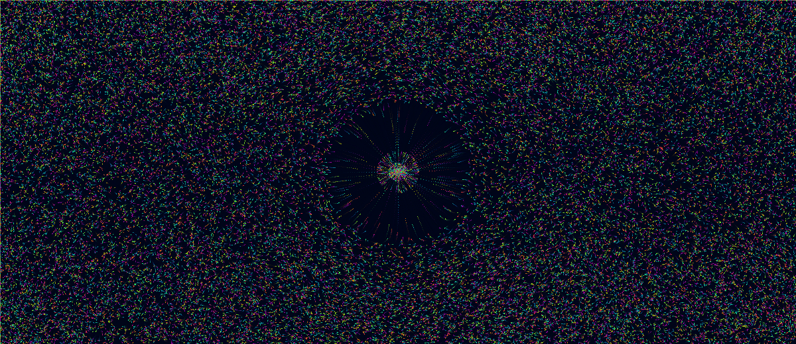

<div align="center">

# Instance

**We paid the abstraction tax so you don’t have to.**

## [Open the live documentation →](https://voidsymbol.github.io/Instance/)

**The page is the real README.** Every example on it runs in your browser, and you can edit each one in place.<br>
The whole test suite runs there too: **[888 cases, one click →](https://voidsymbol.github.io/Instance/?suite)**

</div>

<!-- The symbol. Every line of the drawing is padded with spaces to one width (70): that is what centres it. Keep them. -->
<div align="center">
<pre>
                              _________                               
                         ,,-'':::::::::``-..                          
                      ,/'::::::_______::::::`\.                       
                     /:::::,-''       ``-.:::::`.                     
                    /::::/'     _____     `\:::::\                    
                   /::::/    ,'':::::``.    `.::::\                   
                   |::::|   \:::,--.::::\    `.::::|                  
                   \::::\    `._)   \::::|    |::::|                  
                    \::::`.        ,'::::|    |::::|                  
                     \.::::``-----'::::,/    /::::|                   
                      `\..::::::::::_,''    /::::,'                   
                          ``------'''    ,/'::::/'                    
             ____________            _,-''::::,'                      
        ,-'''::::::::::::``---------'::::::,/'      _______           
     ,/':::::___________:::::::::::::::::,'     ,-'':::::::``-.       
   /'::::,,'''          ``-..:::::::::::/    ,/':::::_____:::::``.    
  /::::,'     _,------_     `\.::::::::/    /'::::,''     ``-.::::`.  
 /::::/    ,/':::::::::``\.    \.:::::|    |::::,'    ___     \:::::\ 
/::::/    /'::::,----.:::::\    `.::::|    |::::|    ':::`\    \::::`.
|::::|    |:::.'      `\::::\    \::::|     \::::\.   )::::|    |::::|
|::::|    \::::`-'`\    |::::|    \::::\    `.:::::`"'::::/    ,'::::|
|:::::\    `\_____,'    |::::|     \::::`.    ``._______/'    ,/::::/ 
 `.::::`.             ,'::::/       \.::::`..               ,/:::::/  
   \.::::``-.______,-'::::,/         `\.:::::`--._______,-''::::,/'   
    ``..:::::::::::::::,,'              `-.::::::::::::::::::,,''     
        `--________,--''                   ``--___________-''         
</pre>
</div>

<div align="center">

**[voidsymbol.github.io/Instance](https://voidsymbol.github.io/Instance/)** — start here

</div>

## Start

```html
<script src="Instance-0.92.6.js" ⚡></script>
```

One tag: the runtime and the compiler. [`Instance-core-0.92.6.js`](Instance-core-0.92.6.js) is the runtime alone, for a page
written in plain JavaScript. Both are at the root of this repository; the five files under `modules/` are what they are built from.

## Chimera

[](https://voidsymbol.github.io/Instance/#throughput)

Sixty thousand particles on one thread, each one an effect of its own, falling past a horizon. This is the black hole
simulator, and what it runs on is Chimera, the signal engine under Instance. **[Run it →](https://voidsymbol.github.io/Instance/#throughput)**

## Funding

*A stub: this section is not written yet.*
