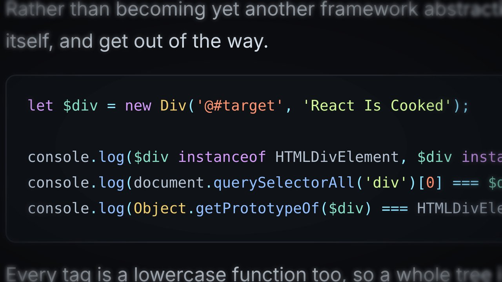

<div align="center">

# Instance

**Instance is a JavaScript UEFI that requires no build step:** `new Div('@#target');`

We paid the abstraction tax so you don’t have to.

### [Open the docsuite](https://voidsymbol.github.io/Instance/)

[Discord](https://discord.gg/tH7eSVRZW) · [YouTube](https://www.youtube.com/@voidsymbol)

</div>

<!-- The symbol. Every line of the drawing is padded with spaces to one width (70): that is what centres it. Keep them. -->
<div align="center">
<pre>
                              _________                               
                         ,,-'':::::::::``-..                          
                      ,/'::::::_______::::::`\.                       
                     /:::::,-''       ``-.:::::`.                     
                    /::::/'     _____     `\:::::\                    
                   /::::/    ,'':::::``.    `.::::\                   
                   |::::|   \:::,--.::::\    `.::::|                  
                   \::::\    `._)   \::::|    |::::|                  
                    \::::`.        ,'::::|    |::::|                  
                     \.::::``-----'::::,/    /::::|                   
                      `\..::::::::::_,''    /::::,'                   
                          ``------'''    ,/'::::/'                    
             ____________            _,-''::::,'                      
        ,-'''::::::::::::``---------'::::::,/'      _______           
     ,/':::::___________:::::::::::::::::,'     ,-'':::::::``-.       
   /'::::,,'''          ``-..:::::::::::/    ,/':::::_____:::::``.    
  /::::,'     _,------_     `\.::::::::/    /'::::,''     ``-.::::`.  
 /::::/    ,/':::::::::``\.    \.:::::|    |::::,'    ___     \:::::\ 
/::::/    /'::::,----.:::::\    `.::::|    |::::|    ':::`\    \::::`.
|::::|    |:::.'      `\::::\    \::::|     \::::\.   )::::|    |::::|
|::::|    \::::`-'`\    |::::|    \::::\    `.:::::`"'::::/    ,'::::|
|:::::\    `\_____,'    |::::|     \::::`.    ``._______/'    ,/::::/ 
 `.::::`.             ,'::::/       \.::::`..               ,/:::::/  
   \.::::``-.______,-'::::,/         `\.:::::`--._______,-''::::,/'   
    ``..:::::::::::::::,,'              `-.::::::::::::::::::,,''     
        `--________,--''                   ``--___________-''         
</pre>
</div>

<div align="center">

**[voidsymbol.github.io/Instance](https://voidsymbol.github.io/Instance/)** — start here · [auf Deutsch →](https://voidsymbol.github.io/Instance/de.html)

</div>

## Instance in five minutes

[](https://youtu.be/sn3I-kk5VG4)

Episode 1: an empty page, `new Div`, a component, and the same component in React. **[Watch it →](https://youtu.be/sn3I-kk5VG4)**

## Start

```html
<script src="https://cdn.jsdelivr.net/npm/@instance-js/instance@0.92" ⚡></script>
```

One tag: the runtime and the compiler, from the npm package [`@instance-js/instance`](https://www.npmjs.com/package/@instance-js/instance)
(version `0.92.17` is the file `0.92.h`: the letter is a base-32 digit). The same file is at the root of this repository as
[`Instance-0.92.h.js`](Instance-0.92.h.js), to host yourself; [`Instance-core-0.92.h.js`](Instance-core-0.92.h.js) is the
runtime alone, for a page written in plain JavaScript. The five files under `modules/` are what they are built from.

```sh
npm install @instance-js/instance
```

`import '@instance-js/instance'` gives a bundler the runtime (the core file): the compiler reads the page from its own
`<script>` tag, so it is for the tag, not for an import.

## Chimera

[](https://voidsymbol.github.io/Instance/#throughput)

Sixty thousand particles on one thread, each one an effect of its own, falling past a horizon. This is the black hole
simulator, and what it runs on is Chimera, the signal engine under Instance. **[Run it →](https://voidsymbol.github.io/Instance/#throughput)**

## Funding

*A stub: this section is not written yet.*

## Licence

Instance is licensed under the [Instance Source License v1.4](LICENSE.md) (ISL): free for individuals and small teams,
paid for by the companies that profit from it. The canonical text lives
[here](https://codeberg.org/voidsymbol/The-Instance-Source-License/src/branch/main). 
